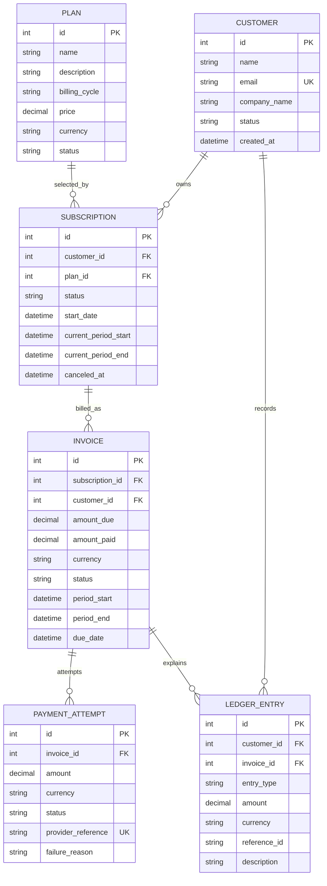

# SubLedger Low-Level Design (LLD)

## 1. Design goals and boundaries

The implementation follows the assignment's requested separation of routes, services, repositories, models, schemas, configuration, and database logic. It is a small billing-domain backend, not a payment gateway. FastAPI provides HTTP/OpenAPI; SQLAlchemy models persistence; Pydantic validates the transport contract.

## 2. Entity relationship diagram



### Relationship notes

- Customer has many subscriptions and ledger entries; Plan has many subscriptions.
- Subscription has many invoices; Invoice has many payment attempts and ledger entries.
- Invoice retains `customer_id` to make customer-level invoice and ledger queries direct and to preserve the billing party at issue time.
- `PaymentAttempt.provider_reference` is unique for retry/event traceability and duplicate submission protection.
- `Invoice.amount_due` and `currency` are snapshots from the plan at invoice creation; subsequent plan edits do not rewrite historical invoices.
- Timestamps are stored as timezone-aware UTC values by application convention.

## 3. Layer responsibilities

| Layer | Responsibility | Must not own |
|---|---|---|
| Routes (`app/api/routes`) | HTTP paths, request/response models, status codes, dependency wiring | Billing calculations or SQL queries |
| Schemas (`app/schemas`) | Input validation, enum/pattern/range constraints, response serialization | Persistence or workflow orchestration |
| Services (`app/services`) | Business rules, orchestration, transaction boundaries, domain errors | HTTP-specific request objects or raw SQL |
| Repositories (`app/repositories`) | Entity lookup, list queries, persistence add/flush | Pricing/payment business decisions |
| Models (`app/models`) | Tables, columns, foreign keys, relationships, basic integrity | Multi-step business workflows |
| DB/config (`app/db.py`, `app/core`) | Engine/session lifecycle, environment configuration, common errors | Domain-specific orchestration |

## 4. Repository responsibility table

| Repository | Read methods | Write methods |
|---|---|---|
| PlanRepository | `get`, `list` | `create` (service mutates loaded model for updates) |
| CustomerRepository | `get`, `list`, `by_email` | `create` |
| SubscriptionRepository | `get`, `list`, `active_for_customer_plan` | `create` |
| InvoiceRepository | `get` | `create` |
| PaymentAttemptRepository | — | `create` |
| LedgerRepository | `for_customer` | `create` only; no update/delete methods |

Repositories use an injected SQLAlchemy `Session`. `flush()` makes generated identifiers available while leaving commit/rollback to the service transaction boundary.

## 5. Service responsibility table

| Service | Owns |
|---|---|
| PlanService | Positive price, plan creation/update, activation/deactivation |
| CustomerService | Customer creation, normalized unique email, customer retrieval/list |
| SubscriptionService | Active customer/plan validation, duplicate active subscription rule, cancellation |
| InvoiceService | Active subscription validation, price snapshot, period validation, invoice-created ledger event |
| PaymentService | Invoice/currency/amount validation, attempt creation, invoice balance/status update, payment ledger event |
| LedgerService | Append-only ledger event creation and customer ledger history |

## 6. Business-rule ownership

| Rule from brief | Enforcement point |
|---|---|
| Plan price must be greater than zero | `PlanCreate` schema and `PlanService`; database `Numeric` field stores amount |
| Customer email must be unique | normalized email check in `CustomerService` and unique DB constraint on `customers.email` |
| Cannot subscribe to inactive plan | `SubscriptionService` |
| No two active subscriptions to same plan/customer | `SubscriptionService` query; supporting composite index. A DB partial unique index can be added for stronger concurrent-write guarantees |
| Invoice due amount uses plan price at generation | `InvoiceService` copies plan price and currency into invoice |
| Successful payment cannot exceed remaining amount | `PaymentService` compares amount to `amount_due - amount_paid` |
| Full payment -> paid; partial -> partially_paid | `PaymentService` after successful payment only |
| Failed payment does not increase amount_paid | `PaymentService` records attempt/event but does not update invoice balance |
| Ledger is append-only and traceable | `LedgerService`/`LedgerRepository` expose create/read only; ORM hook blocks update/delete; every entry has `reference_id` |

The service check is the readable business guard. Database uniqueness constraints provide a second line of defense for customer email and provider references. Concurrent subscription creation should use a partial unique index or serializable/locked transaction in production; the base assignment version implements the required service-level guard.

## 7. Design pattern and dependency management

**Repository + Service Layer pattern** is used. Route handlers construct a small service bundle using the request-scoped database session. Services receive repositories through constructor injection. This isolates HTTP, domain workflows, and persistence, makes business logic unit-testable, and avoids creating sessions inside repositories. A single request-scoped SQLAlchemy session is shared by the repositories participating in one workflow so invoice/payment plus ledger changes commit atomically.

## 8. Invoice generation flow

```mermaid
sequenceDiagram
    participant R as Invoice Route
    participant S as InvoiceService
    participant SR as SubscriptionRepository
    participant PR as PlanRepository
    participant IR as InvoiceRepository
    participant L as LedgerRepository
    R->>S: generate(subscription_id, optional period)
    S->>SR: get subscription
    SR-->>S: subscription
    S->>S: verify active; validate period
    S->>PR: get plan
    PR-->>S: plan price and currency
    S->>IR: create invoice with price snapshot
    S->>L: create invoice_created event
    S->>S: commit transaction
    S-->>R: invoice
    R-->>R: 201 response
```

1. Route validates `subscription_id` and optional period bounds.
2. InvoiceService retrieves the subscription and rejects missing/inactive subscriptions.
3. It loads the related plan and snapshots its current price/currency.
4. It validates `period_end > period_start`, then creates an issued invoice with zero amount paid.
5. It appends `invoice_created` to the ledger using `invoice:<id>` as reference.
6. Invoice and ledger event commit in the same transaction.

## 9. Payment recording flow

```mermaid
sequenceDiagram
    participant R as Payment Route
    participant S as PaymentService
    participant IR as InvoiceRepository
    participant PAR as PaymentAttemptRepository
    participant LR as LedgerRepository
    R->>S: record(invoice, amount, currency, status, reference)
    S->>IR: get invoice
    IR-->>S: invoice
    S->>S: validate currency, status and remaining balance
    S->>PAR: create payment attempt
    alt success
      S->>S: increase amount_paid; set paid/partially_paid
      S->>LR: append payment_success
    else failed
      S->>S: leave amount_paid unchanged
      S->>LR: append payment_failure
    end
    S->>S: commit transaction
    S-->>R: attempt + invoice
```

1. Route validates the payment payload and sends it to PaymentService.
2. Service retrieves the invoice, verifies currency and payable state, and checks a successful amount does not exceed the remaining balance.
3. It creates a payment attempt. On success it increments `amount_paid` and derives `paid` or `partially_paid`; on failure it leaves the invoice balance/status untouched.
4. It appends a corresponding ledger event keyed by the provider reference.
5. Attempt, invoice update, and ledger entry commit atomically.

## 10. Status model and assumptions

- Plan: `active`, `inactive`.
- Customer: `active` (future lifecycle states can be introduced).
- Subscription: `active`, `canceled`.
- Invoice: `issued`, `partially_paid`, `paid`, `overdue`, `void` (this implementation transitions `issued` -> `partially_paid` -> `paid`; overdue/void are reserved states).
- PaymentAttempt: `success`, `failed`.
- Ledger event types: `invoice_created`, `payment_success`, `payment_failure`.
- Billing cycle durations are simplified to 30, 90, and 365 days; production should use calendar-aware recurrence rules.
- External gateway callbacks are represented by the caller-supplied payment result. No processor is integrated.
